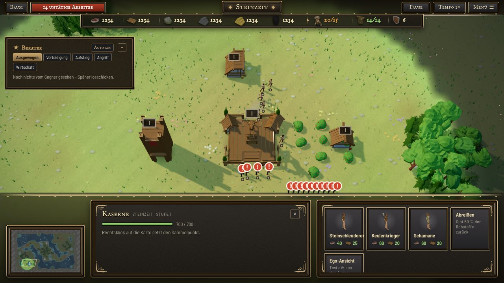
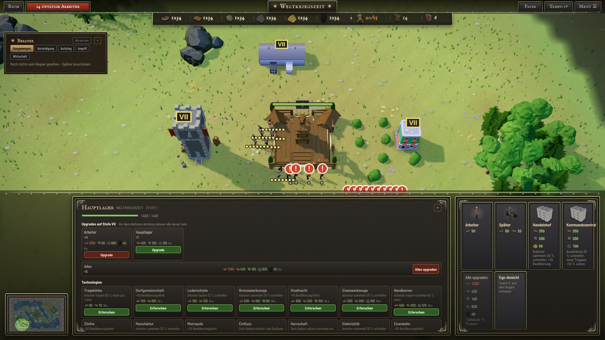
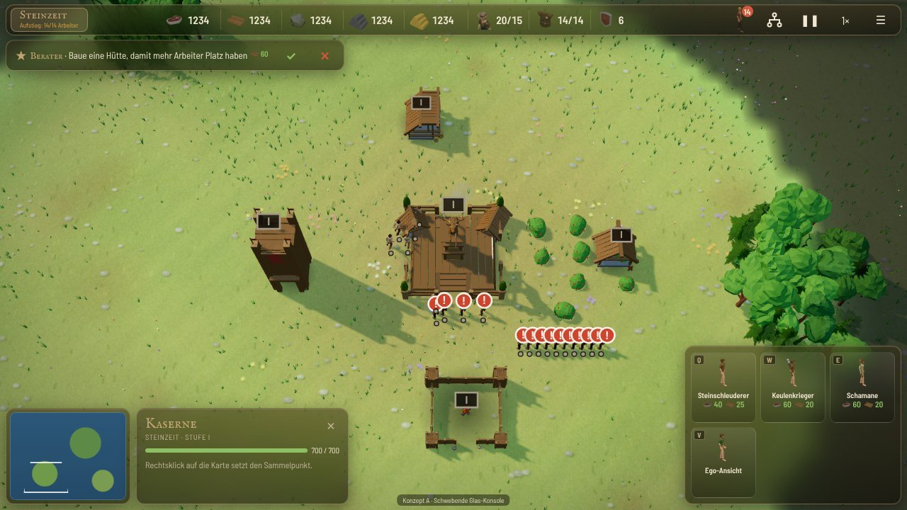
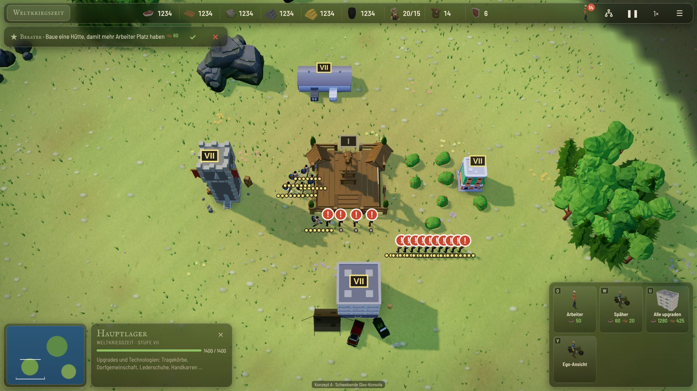
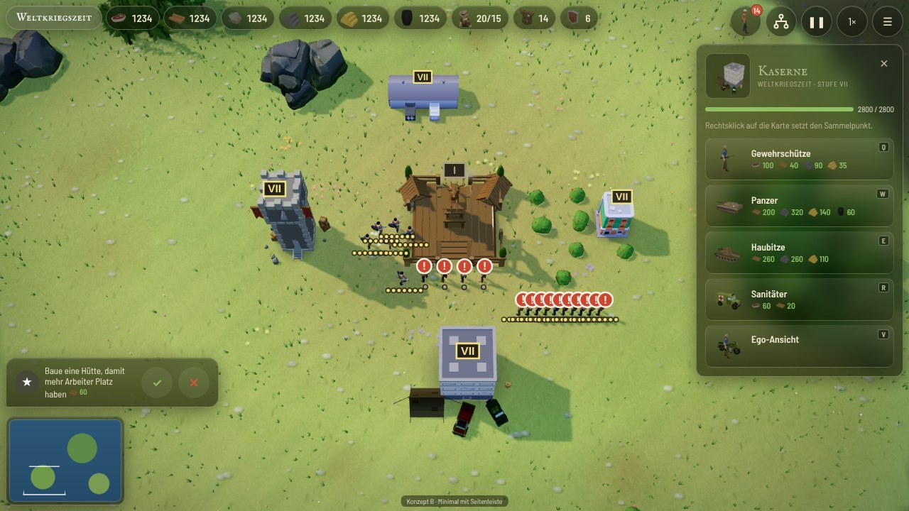
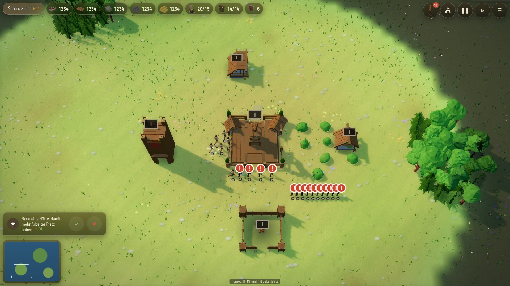

# UI-Konzept (Paket L): Oberfläche auf neuem Niveau

Stand 21.10. Nur Konzept, am Spiel wurde nichts geändert. Mockups zum Anschauen (HTML, Spielbild als Hintergrund):
`tools/ui-konzept/a.html` und `b.html`, per Browser öffnen (`npx serve .` im Hauptordner, dann `/tools/ui-konzept/a.html`).
Wechsel per Adresszeile: `?ep=0` oder `?ep=6` (Zeitalter), `&sel=none|worker|barracks|hq` (Auswahl), `&adv=0` (ohne Berater), `&menu=1` (Menü offen).
Alle Bilder liegen in `tools/ui-konzept/bilder/` (`ist-*` = heute, `a-*` und `b-*` = Entwürfe, Endung `-1280` oder `-1920`).

## 1. So sieht es heute aus

Bilder: `ist-ep0-kaserne-1280.jpg`, `ist-ep0-berater-1280.jpg`, `ist-ep6-kaserne-1280.jpg`, `ist-ep6-hauptlager-1920.jpg`, `ist-ep0-menue-1280.jpg`, dazu je Arbeiter/Hauptlager/Kaserne in 1280 und 1920.

Gemessener Platz (gemessen im Spiel, `masse.json` und `massebig.json`):

| Teil | 1280×720 | 1920×1080 |
|---|---|---|
| Obere Leiste (zwei Ebenen: Knöpfe + Rohstoff-Tafel) | 77 px hoch, fast 11 % der Höhe | 85 px |
| Konsole unten (Info + Aktionen + Minikarte) | 230 px = 32 % der Höhe | 356 px (Steinzeit) bis **475 px** (Hauptlager mit Technologien, Weltkriegszeit) |
| Berater (offen) | 330×135 px, mitten im Bild links oben | gleich |
| Minikarte | 200×134 px, sitzt in der Konsole | gleich |
| **Verdeckte Fläche insgesamt** | **ca. 41 %** (mit Berater 45 %) | 39 % (Steinzeit) bis **52 %** (Hauptlager Weltkriegszeit) |
| Freies Spielfeld in der Höhe | 413 von 720 px (57 %) | nur 520 von 1080 px (48 %) bei großer Konsole |

Schwächen:
- Die Konsole ist immer da, auch ohne Auswahl, und nimmt die ganze Breite. Die Mitte (Info) ist bei Arbeitern und Kasernen fast leer, bei Hauptlager/Technologien dagegen so voll, dass sie wächst und die Spielfläche springt.
- Dicke, undurchsichtige Rahmen mit Verzierungen (dunkler Stein, Bronze). Die Konsole ist ein fester Balken: man sieht nichts darunter.
- Obere Leiste braucht zwei Ebenen, viel Leerraum links und rechts neben der Tafel.
- Der Berater ist ein großer Kasten mitten im Bild, auch wenn er nur "Noch nichts vom Gegner gesehen" sagt.
- Kachel-Beschriftung wird bei langen Namen abgeschnitten ("Steinschleuderer" stößt an den Rand, "Ego-Ansicht" wird unten abgeschnitten).
- Auf kleinen Bildschirmen (unter 760 px Höhe) wird die Konsole auf 32 % der Höhe gedeckelt und scrollt.

## 2. Zwei Entwürfe

Gemeinsam: Zeitalter-Farben bleiben (`--fr` und Tönung aus `body[data-ep]`), echte Symbole (Rohstoffe und Kachelbilder aus `ICON3`), Glas-Look (halbtransparent, Weichzeichner), alle Knöpfe mindestens 44 px (gemessen in beiden Entwürfen: kleinster Knopf 44 px bei 1280, 57 px bei 1920). Tastenkürzel stehen als kleines Schild auf jeder Kachel.

### Variante A: schwebende Glas-Konsole

- Oben eine einzige schlanke Glasleiste (44 px): Zeitalter links, alle Rohstoffe in der Mitte, rechts Arbeiter-Knopf (mit roter Zahl), Baum, Pause, Tempo, Menü.
- Unten links schwebt eine Karte mit Minikarte und Info daneben, unten rechts eine Karte mit den Aktionen. Dazwischen ist das Spielfeld frei. Ohne Auswahl bleibt nur die Minikarte.
- Berater als schmale Pille unter der Leiste (Text, Ja/Nein), klappt bei Bedarf auf.
- Verdeckt: 22,8 % (1280, mit Berater und Auswahl), 17,8 % (1920); ohne Auswahl 10,9 % bzw. 8,9 % (heute: ca. 41 %).

### Variante B: minimal mit Seitenleiste

- Rohstoffe als kleine Glas-Chips oben links, runde Knöpfe oben rechts. Keine Leiste, das Bild geht bis zum Rand.
- Info und Aktionen stehen in einer Seitenleiste rechts, nur bei Auswahl. Die Aktionen sind Zeilen (Bild, Name, Kosten, Taste) statt Kacheln, dadurch gibt es nie abgeschnittene Namen und bei vielen Technologien kann die Leiste einfach scrollen.
- Minikarte klein unten links (immer da), Berater als Sprechblase darüber.
- Verdeckt: 21 bis 23 % (1280, mit Auswahl und Berater), 16 bis 17,5 % (1920); ohne Auswahl 8,3 % bzw. 6,2 %.

### Vergleich

| | Heute | A | B |
|---|---|---|---|
| Verdeckt, mit Auswahl, 1280 | 41 bis 45 % | 22,8 % | 21 bis 23 % |
| Verdeckt, mit Auswahl, 1920 | 39 bis 52 % | 17,8 % | 16 bis 17,5 % |
| Verdeckt, ohne Auswahl, 1280 | 41 % | 10,9 % | 8,3 % |
| Spielfeld springt bei Auswahlwechsel | ja (Konsole wächst) | nein (feste Karten) | nein (Seitenleiste überdeckt nur den rechten Rand) |
| Wiedererkennung / Nähe zu heute | hoch | hoch (gleiche Bereiche, nur leichter) | mittel (neue Gewohnheit: Aktionen rechts) |
| Viele Technologien (Hauptlager) | Konsole wird riesig | Karte müsste scrollen oder aufklappen | Seitenleiste scrollt natürlich |
| Touch / Tablet | gut | gut, Daumen unten | Daumen rechts, auch gut |
| Mehrspieler-Anzeigen (Ping-Abzeichen, Warnungen) | vorhanden | Platz unter der Leiste | Platz unter den Chips |

Hinweis zu den Zahlen: Das Mockup nutzt die echten Größen, aber nur einen Beispiel-Inhalt (Kaserne, Arbeiter, Hauptlager). Echte Hauptlager-Technologien brauchen in A und B mehr Höhe; in B scrollt die Leiste (bis fast Vollhöhe, dann ca. 33 % verdeckt), in A müsste die Aktionskarte ebenfalls scrollen oder ein Reiter "Technologien" bekommen.

## 3. Empfehlung

**B als Ziel, aber in zwei Schritten gebaut.** B gewinnt, weil sie bei Auswahl und ohne Auswahl am wenigsten Spielfeld verdeckt, bei vielen Technologien (Hauptlager, Weltkriegszeit) das Wachsen-Problem sauber löst und am modernsten wirkt. A ist die sichere Zwischenstufe: sie kommt dem heutigen Bedienkonzept am nächsten.

Vorschlag:
1. Schritt 1 (kleiner Umbau, gleich mit sichtbarem Gewinn): Glas-Material (halbtransparent, Weichzeichner, dünner Zeitalter-Rand) auf obere Leiste, Konsole, Berater und Menü anwenden, Berater als Pille/Blase. Das ist Variante A ohne Layout-Umzug.
2. Schritt 2: Layout nach B (Chips, Seitenleiste, Minikarte frei im Eck). Davids Entscheidung nach Ausprobieren der Mockups.

Offene Wahl für David: A (vertraut, 2-3 Tage) oder B (mutiger, 4-6 Tage)?

## 4. Aufwand (Schätzung, Dateien)

| Aufgabe | Dateien | A | B |
|---|---|---|---|
| Neues Stil-Paket (Glas, Zeitalter-Farben), alte Zierrahmen abschalten | `css/style.css` (Blöcke "Neues Oberflächen-Design", "Rahmen 3", PC-Look: ca. 49 Stellen mit `#panel/#top/#info/#acts`), `css/topbar.css` (ersetzen), neue `css/ui2.css` | 1 Tag | 1 Tag |
| Seitenaufbau | `index.html` (`#top`, `#panel`, `#info`, `#acts`, `#mini`) | klein | mittel |
| Info-Feld und Aktionen (Kachel bzw. Zeile), Upgrade-/Technologie-Kacheln, Sperrgründe | `js/ui.js` (`actionsFor`, `actIcon`, Info-Zeichnung, `panelSig`), `css/style.css` | 1 Tag | 1,5 Tage |
| Rahmen-Zierde | `js/skin.js` (`--orn-*`, `--topH`) auf einfache Ränder reduzieren | 0,25 Tag | 0,25 Tag |
| Minikarte neu platziert | `js/render.js` (Zeichnen/Klick auf `#mini`), `js/input.js` (Klicktest, `MW/MH`) | klein | klein |
| Kamera-Rand und Schutzflächen | `js/input.js` (`uiInsets`, `freeCenter`, `clampCam`: bisher nur oben/unten, bei B zusätzlich rechts, bei A zwei Ecken) | 0,5 Tag | 0,75 Tag |
| Berater | `js/advisor.js` (`advisorUI`, Taste Y/X bleibt), `css` | 0,5 Tag | 0,5 Tag |
| Menü/Optionen im gleichen Stil | `js/ui.js` (`renderMenu`, `renderOptions`), `css/style.css` | 0,5 Tag | 0,5 Tag |
| Test (1280, 1920, Mobil, alle Zeitalter, Mehrspieler) und QA-Runde (`epochen-qa`) | alle | 0,5 Tag | 1 Tag |
| **Summe** | | **etwa 3 bis 4 Tage** | **etwa 5 bis 6 Tage** |

## 5. Risiken

- **Tastenkürzel:** Die Tasten bleiben (`KEYDEF`, `kA(e)`); die Schilder auf den Kacheln müssen aus den eingestellten Tasten kommen, nicht fest geschrieben sein (im Mockup nur Beispiele). Bei B wandert die Tastenleiste für Befehle (F1/F2/F4 Gruppen) nicht, nur die Anzeige.
- **Tooltips:** `data-tt`/`TIPS`/`#tip` sind an Positionen der alten Konsole gewöhnt (Tooltip erscheint oberhalb der Kachel). In der Seitenleiste (B) muss er nach links aufgehen, in A nach oben. Prüfen: abgeschnittene Tooltips am Bildrand.
- **Lesbarkeit auf Glas:** Hell/Gras-Hintergrund (Steinzeit) und dunkler Boden unterscheiden sich stark; die Glasfläche braucht genug Dunkelheit (im Mockup 50 bis 58 % Deckung, Kontrast geprüft nur mit Augenmaß). Weichzeichner (`backdrop-filter`) kostet Leistung über dem WebGL-Bild; die heutige Leiste benutzt ihn schon, im Sparmodus (`OPT`/Grafik Niedrig) auf einfache dunkle Fläche zurückfallen.
- **Mehrspieler-Anzeigen:** `#netbadge`/`#netpanel` (netlog.js), Pausen-Hinweis, "Gastgeber wartet"-Meldungen und Toasts (`#toasts`) sitzen heute neben der oberen Leiste; müssen im Mockup-Layout neue feste Plätze bekommen (A: unter der Leiste rechts, B: unter den Knöpfen). Im Mehrspieler gibt es keinen Berater, der Platz bleibt frei.
- **Mobil/Touch:** 44-px-Mindestgröße ist eingehalten, aber bei Hochformat (unter 640 px Breite) passen 8 Rohstoff-Chips nicht in eine Zeile: Chips müssen umbrechen oder auf Symbol + Zahl gekürzt werden; Seitenleiste (B) wird dort zur unteren Schublade. Heute gibt es dafür eigene Regeln (`@media max-width:900px/640px` in `style.css`/`topbar.css`), die müssten neu geschrieben werden.
- **Auswahl/Klicks:** Die freie Fläche ändert sich; `clampCam`, `centerOn`, Randscrollen und das Verdecken von Klicks (`#top > *` fängt Klicks, daneben gehen sie zur Karte) müssen mit den schwebenden Karten stimmen (sonst Klick "auf die Karte" durch das Glas).
- **Ego-Ansicht, Menü, Zeitalter-Baum, Hauptmenü/Spielzimmer:** nutzen `body.menu-open` (blendet heute `#panel` aus), `body.mm`, `body.room` - alle Schalter müssen auf die neuen Elemente umgestellt werden.
- **Davids Vorgabe "Modelle nie blind einbauen":** Die Kachelbilder (`ICON3`) sind Renderings echter Modelle; in einer 48-px-Kachel (A) sind sie kleiner als heute (64 px). Mit der Zeilen-Lösung in B (46 px) ähnlich. Vor dem Umbau mit Davids Lieblingskacheln gegenprüfen.

## 6. So wurde gemessen und gebaut

- Screenshots mit Playwright (Software-GL, eigener Port 8461 auf den Worktree), Spiel `newGame` Küste M, Zeitalter 0 und 6 gesetzt, Gebäude/Einheiten hinzugefügt, Berater geöffnet, Menü per `toggleMenu()`.
- Mockups sind reines HTML/CSS/JS (`shared.css`, `shared.js`, `a.html`, `b.html`), Symbole als PNG aus `ICON3` in `bilder/ic/`, Spielbild ohne Oberfläche als `bilder/bg-ep*-*.jpg`. Verdeckte Fläche aus den Rechtecken aller Glas-Elemente (keine Doppelzählung).
- Heute-Zahlen: `masse.json` (1280) und `massebig.json` (1920) mit den echten Rechtecken; Entwurf-Zahlen: `masse-mockups.json`.
